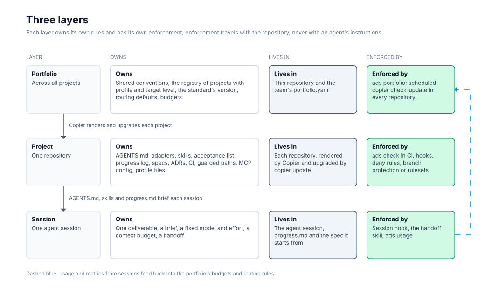

# ai-delivery-standard

A versioned standard for building and running software with AI coding agents across a whole portfolio of repositories, so that context, sessions and token cost stay bounded and every change is validated before it ships. It is packaged as a [Copier](https://copier.readthedocs.io/) template with a conformance checker, and its rules come from a dated review of vendor documentation, open specifications, research and one developer's measured sessions ([docs/evidence.md](docs/evidence.md)).

## What it does

- **Renders a project** with the files its type and level need: a short, tool-neutral `AGENTS.md`, lifecycle skills in `.agents/skills/`, one check command, CI with gates, guarded paths, an acceptance list, a progress log, specs and ADRs, optional product modules for multi-user data, EU personal data and AI extraction, and optional diagrams designed in Penpot and published as SVG.
- **Upgrades projects in place**: `copier update` replays each new version onto existing repositories as a reviewable diff, and a scheduled CI job warns when a project is behind.
- **Checks conformance**: `ads check` scores a repository against its profile and level (L1 baseline, L2 gated, L3 measured); `ads portfolio` does it for every project in a registry.
- **Measures sessions**: `ads usage` reads Claude Code transcripts and reports context per call, the metric behind the session rules.

The normative rules are in [STANDARD.md](STANDARD.md): three layers (portfolio, project, session), five profiles (`product`, `service`, `research`, `site`, `demo`), three levels, context, session and cost rules with numeric limits, human gates and metrics. How to work with it day to day, step by step and who acts at each one, is in [docs/workflow.md](docs/workflow.md).



## How it is organised

| Path | Content |
|---|---|
| `STANDARD.md` | The standard: levels, rules, gates, metrics, versioning |
| `copier.yml`, `template/` | The Copier questions and the files it renders; `template/_skills/` holds the single source of every skill |
| `checker/` | The `ads` Python package (conformance rules, portfolio report, usage metrics) and its tests |
| `scripts/ads.sh`, `scripts/ads.ps1` | Run everything in Docker |
| `docs/` | [Workflow](docs/workflow.md), [evidence](docs/evidence.md), [adoption](docs/adoption.md), [portfolio](docs/portfolio.md) |
| `CHANGELOG.md`, `DEPRECATIONS.md` | Release history and deprecation notices |

## How to run it

Requirements: Docker and Git (Git Bash on Windows).

```
git clone https://github.com/jesusroncal94/ai-delivery-standard
cd ai-delivery-standard
scripts/ads.sh new ../my-project          # render a new project
scripts/ads.sh adopt ../existing-repo     # add the standard to a repository
scripts/ads.sh check ../my-project        # conformance report
scripts/ads.sh update ../my-project       # upgrade to the latest version
scripts/ads.sh portfolio ../portfolio.yaml
scripts/ads.sh usage                      # context per call from ~/.claude/projects
docker compose run --rm tests             # this repository's test suite
```

Copier can also be used directly: `copier copy --trust gh:jesusroncal94/ai-delivery-standard my-project`. The `--trust` flag is needed because the template uses Jinja includes for skills; it runs no tasks.

## Deliberate simplifications

- Token counts are estimated at four characters per token; the limits are policies, not exact budgets.
- The checker verifies files and configuration, not behaviour: whether agents follow the session rules shows up in `ads usage` and the metrics, not in `ads check`.
- Branch protection and rulesets are documented but not checked, because reading them needs repository-admin API access.
- Only Claude Code transcripts are parsed by `ads usage`; other tools need their own OpenTelemetry export.
- The solo-developer substitute for a second reviewer (a fresh-context review plus required CI) is untested; see the open questions in [docs/evidence.md](docs/evidence.md#what-remains-open).

## Licence

[MIT](LICENSE).
