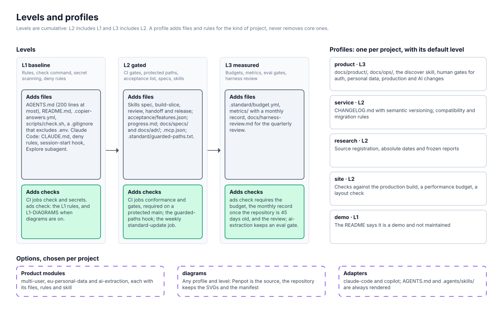
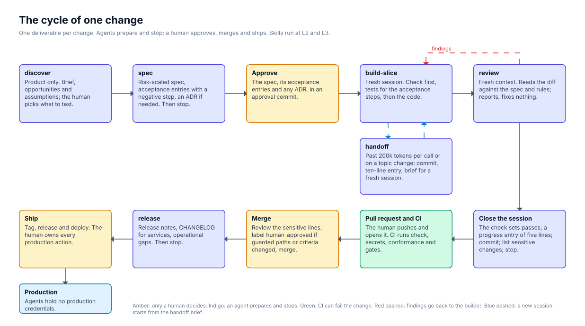
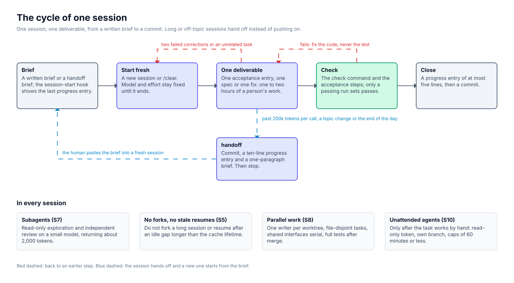

# Working with the standard

How a project on the standard is worked day to day: who does what, in which order, and which rule or check holds each step. The rules themselves are in [STANDARD.md](../STANDARD.md) and the step-by-step instructions agents follow are the skills in [`template/_skills/`](../template/_skills/); this guide only puts them in order. Setup details are in [adoption.md](adoption.md) and [portfolio.md](portfolio.md).

Three roles act:

| Role | Does | Never does |
|---|---|---|
| Human | Decides, approves, labels, merges, releases, runs anything irreversible | Hands a credential or production access to an agent |
| Agent | Prepares: specs, code, tests, reviews, release notes, handoffs | Pushes, merges, releases, deploys, edits guarded paths, reads `.env` |
| Sensors | Fail a change that breaks a rule: the check command, CI jobs, hooks, deny rules, `ads check` | Decide; a green run is necessary, not sufficient |

Work happens at three moments: once when a project starts or adopts the standard, for every change, and on a schedule across the portfolio. They follow the standard's three layers: the portfolio, each project and each session.

## 1. Start or adopt a project

| Step | Who | What |
|---|---|---|
| Choose profile and level | Human | One profile per project (`product`, `service`, `research`, `site`, `demo`) and a target level (L1 baseline, L2 gated, L3 measured). The default level is L3 for products, L1 for demos and L2 otherwise. |
| Render | Human | `scripts/ads.sh new ../my-api` for a new project, or `scripts/ads.sh adopt ../legacy` on a branch for an existing one. Copier asks for the profile, level, modules, adapters, diagrams and check command; `--data-file /cwd/portfolio-defaults.yml` reuses the portfolio's answers. |
| Finish the setup | Human | Fill in the Commands section of `AGENTS.md` and the check command, `git init -b main`, push, protect `main` with the `standard` workflow's checks as required, create the `human-approved` label. |
| Reach the target | Human, then agents | Run `scripts/ads.sh check <dir>` until the project conforms. An adopted repository starts at L1, merges, and raises its level one step at a time with `scripts/ads.sh update <dir> --data level=2`. |

What gets rendered, cumulatively:

| Level | Adds |
|---|---|
| L1 | `AGENTS.md`, `README.md`, `.copier-answers.yml` (version, profile, level), `scripts/check.sh` and `check.ps1`, a `.gitignore` that excludes `.env`, and CI with the `check` and `secrets` jobs (none when `local_only`). With the Claude Code adapter: `CLAUDE.md` (`@AGENTS.md`), deny rules for `git push`, `gh pr merge` and `.env`, a session-start hook and a small-model `Explore` subagent. |
| L2 | The skills `spec`, `build-slice`, `review`, `handoff` and `release` in `.agents/skills/` (mirrored to `.claude/skills/`), `acceptance/features.json`, `progress.md`, `docs/specs/`, `docs/adr/`, `.mcp.json`, `.standard/guarded-paths.txt` with its hook and `scripts/check-gates.sh`, and the CI jobs `conformance`, `gates` and the weekly `standard-update`. |
| L3 | `.standard/budget.yml` (weekly budget, session limits, headless caps), `metrics/` for the monthly record and `docs/harness-review.md` for the quarterly review. `ads check` asks for the monthly record once the repository is 45 days old, and products with `ai-extraction` keep an eval gate. |

Profiles and options add on top: `product` adds `docs/product/`, `docs/ops/` and the `discover` skill; `service` adds `CHANGELOG.md`; `research` adds source registration, absolute dates and frozen reports; `site` adds checks against the production build, a performance budget and a layout check; a `demo` says in its README that it is not maintained; the product modules add `docs/security/`, `docs/privacy/` with the `privacy-check` skill, or `evals/` with the `eval` skill; `diagrams` adds `docs/design/`, `docs/diagrams/`, the `update-diagram` skill and rule L1-DIAGRAMS. Skills are rendered at L2 and L3 only; at L1 the session rules live in `AGENTS.md` alone.

## 2. The cycle of one change

One change is one deliverable (S1): one acceptance entry, one spec or one fix, sized well below what an agent can finish, by default one to two hours of a person's work (S9). The skills below are rendered at L2 and L3.

| # | Step | Who | What happens | Rules and sensors |
|---|---|---|---|---|
| 1 | `discover` (product only) | Agent prepares, human decides | Frame the brief, the opportunity tree and the assumptions; propose the riskiest assumption, its cheapest test and the walking skeleton. Never simulate users. | The human picks the assumption to test and approves the slice, recorded in `docs/product/assumptions.md`. |
| 2 | `spec` | Agent | Size the change (full spec for data model, auth, money or personal data; quick otherwise; none for a one-line fix), write `docs/specs/<ID>-<slug>.md`, propose acceptance entries with at least one negative step and, for a hard-to-reverse choice, an ADR with status `proposed`. Then stop. | Planning runs on the top model (R2). |
| 3 | Approve | **Human** | Approve the spec, its acceptance entries and any ADR, in an approval commit. Acceptance criteria change only with the human from here on. | `check-gates.sh` fails a PR that changes criteria without the `human-approved` label. |
| 4 | `build-slice` | Agent, in a **fresh session** | Read `AGENTS.md`, the last progress entry, the spec and its entries; run the check first; write the tests for the acceptance steps, then the code; never edit a test or reword a criterion to pass. | S2 (fresh session after a spec), S6 (fixed model and effort), mid-tier model at medium effort (R2). With Claude Code, the guarded-paths hook blocks edits to `AGENTS.md`, `.github/*`, `.standard/*` and the other guarded paths. |
| 5 | `review` | Agent, in a **fresh context** | A subagent or new session that did not write the code reads the diff against the spec and rules: tests that would fail without the change, no changed tests, criteria or guarded paths, no secrets or personal data, justified dependencies, negative authorisation tests, nothing outside the spec. It reports findings and fixes nothing. | S7 (review subagents return about 2,000 tokens at most). The builder fixes; the human decides disagreements. |
| 6 | Close the session | Agent | Run the check and the acceptance steps; only a passing run sets `passes: true`. Append a progress entry of at most five lines, commit, list for the human every change to auth, personal data, secrets, migrations, CI or infrastructure, and stop. | S11. |
| 7 | Pull request | Human opens, CI runs | Agents do not push (a prohibition in `AGENTS.md` and, with Claude Code, a deny rule), so the human pushes and opens the PR. CI runs `check` (the project's check command), `secrets` (gitleaks over the whole history), `conformance` (`ads check`) and `gates` (guarded paths, acceptance criteria, conflict markers). | The human adds `human-approved` after reviewing any change to guarded paths or criteria. |
| 8 | Merge | **Human** | Review the listed sensitive lines and merge to `main` behind the required checks. In a team, a second human approves; a solo developer relies on step 5 plus required CI, an untested substitute. | Agents are denied `gh pr merge`. |
| 9 | `release` | Agent prepares, **human** ships | Confirm every entry in the release passes and CI is green (and the eval report is current if AI behaviour changed), write release notes and, for services, the `CHANGELOG.md` entry; report gaps in backups and restore tests, alerts, spend caps and migration order. | The human tags, releases and owns every production action; agents hold no production credentials. |

### Sessions inside the cycle

- **Brief first** (S2): every session starts from a written brief; at L2 and L3 the session-start hook prints the last entry of `progress.md`.
- **Hand off** (S4): when context per call passes 200,000 tokens, before switching to an unrelated task, or at the end of a working day, the agent runs `handoff`: commit finished work, leave unfinished work on its branch, append an entry of at most ten lines, give the human a one-paragraph brief for the next session, and stop. The human pastes the brief into a fresh session.
- **Start over** (S3): `/clear` or a new session between unrelated tasks; after two failed corrections, restart with a better prompt.
- **No forks, no stale resumes** (S5): do not fork a long session, and do not resume after an idle gap longer than the cache lifetime unless the history is needed.
- **Subagents** (S7): broad read-only exploration and independent review run on a small model and return summaries, not file dumps.
- **Parallel work** (S8): one writer per worktree, file-disjoint tasks, shared-interface changes serial, full tests after merging.
- **Unattended agents** (S10): only after the task works by hand, with a read-only token, an agent-prefixed branch, no self-approval and turn, budget and time caps of 60 minutes or less; adding one is a human gate.

### Changes that add a gate

| Change | Extra step |
|---|---|
| `AGENTS.md`, CI, guarded paths, the rules | The hook blocks the agent; the human makes or approves the change and labels the PR `human-approved`. |
| A model, prompt version or provider for an AI feature | The `eval` skill runs the golden set and writes a report; the eval gate passes, then the human approves. |
| A new data class, processor or AI feature on EU personal data | The `privacy-check` skill traces the data flows and drafts the DPIA; the human signs it. |
| A dependency, MCP server, paid service or unattended agent | The human approves it on the PR checklist; `ads check` flags MCP servers over the limit of five. |
| A diagram | The `update-diagram` skill edits it in Penpot; the human approves the board and exports the SVG. |
| Anything irreversible or destructive | The agent hands over the command; the human runs it. |

## 3. Maintain the portfolio

| When | Who | What |
|---|---|---|
| Every PR | CI | `check`, `secrets`, `conformance` and `gates` (L2 and up). |
| Weekly | CI, then human | The `standard-update` job runs `copier check-update` and fails with a warning when a newer version exists. The human reviews usage and trims any skill, MCP server or file that takes 10% of usage or more (R6). |
| Monthly | Human | `scripts/ads.sh portfolio portfolio.yaml` reports every project's achieved level and failing rules, including unadopted repositories. `scripts/ads.sh usage` gives context per call (P50, P90, sessions over 200,000 tokens) for the metrics record each L3 project writes in `metrics/YYYY-MM.md`. The `release` skill's operational checks also run monthly. |
| Quarterly | Human | The harness review in `docs/harness-review.md` for each L3 project: what recurred, which guide or sensor changed, what scaffolding no longer earns its cost. Review the standard against its triggers in [evidence.md](evidence.md#review-triggers). |
| On a new version | Human, agent helps | On a branch, `scripts/ads.sh update <dir>` replays the new version as a diff. The human resolves conflicts (`check-gates.sh` fails while any marker or `.rej` file remains), labels the PR `human-approved`, because `.copier-answers.yml` and `AGENTS.md` are guarded, and merges. |

What sessions measure feeds the portfolio back: the usage review (R6) and the metrics decide the budgets (R1) and which routing rules are kept (R4). Read the metrics as trends over 8–12 weeks, never week to week, and never rank people by tokens (R7).
